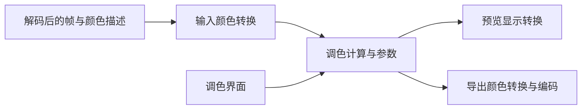

# 立项书：OpenCut 个性化调色剪辑器

版本：0.25。研究截止日期：2026-10-14。封存日期：2026-10-15。状态：已封存；完整产品开发尚未开始。0.25完成新近黑灰阶在−1/+1存储值下的前瞻原生对照，固定主模型96个中心及各档ROI通道最大误差1.788e−7，通过预定1e−6门，未改预测或拟合参数。六个新任务完成，两档重放和中性恢复全图逐位一致；005的冻结getter/对象与23个原任务已于2026-10-14核查，009完成归档及008失败归档保留。累计60张正式EXR；固定无Y夹紧理想CPU候选被排除，实际运行路径与完整公式仍未验收。[本轮结果](research/hdr-near-black-native.md)、[独立审查](reviews/hdr-near-black-native-review.md)。0.24的三个未见参数值结果和0.17的默认Global静态赋值／分区OR边界保留，历史冻结不改写。

封存决定和恢复入口见[2026-10-15封存记录](archive-2026-10-15.md)。以下保留原立项依据及截至0.25的研究结果；后续计划暂停，等待用户明确恢复。

## 要解决的问题

用户希望拥有一款能长期改造、可开源、有个人风格的剪辑软件。专业调色是首个研究方向：理解 DaVinci Resolve 为什么易于精细控制画面，再将可独立实现的能力纳入 OpenCut 新核心。

用户已明确选择参与 OpenCut 正在进行的重写。开发底座为 [OpenCut-app/OpenCut](https://github.com/OpenCut-app/OpenCut)，旧 classic 是参照资料，不是本项目的开发主线。

## 已知事实与当前假设

| 类别 | 内容 |
|---|---|
| 已确认的用户意图 | 自己的 fancy 开源剪辑器；研究调色；参与 OpenCut 新主线重写 |
| 已核查的代码事实 | 新主线 web 编辑页、desktop 预览仍为占位；暂不能作为已经贯通的视频编辑器。具体文件见源码研究 |
| 已核查的上游声明 | Rust 核心、插件、Editor API、MCP、headless 被列为未来方向；暂未开放外部贡献 |
| 本机事实 | Resolve 21.1.1.10 已完成中性/CDL、HDR三档、Gamma配置、黑场偏移、接近零、混色、三个未见存储值及新近黑灰阶对照共60张正式单帧浮点EXR；原HDR −1/0/+1离散UI校准、黑场偏移0→0.010单点载体关联已完成；完整曝光公式仍未验收 |
| 产品假设 | 初期用于 Windows 本地个人剪辑；首个视频验收限定 1080p SDR；不承诺三端同步交付 |
| 未定偏好 | 第一版优先电影感预设、局部调色还是参考色调匹配；界面风格、名称和品牌仍未定 |

上游事实依据：[固定基线 README](https://github.com/OpenCut-app/OpenCut/blob/e668010778568641babef2cc40be4703ae6916d6/README.md)、[编辑页](https://github.com/OpenCut-app/OpenCut/blob/e668010778568641babef2cc40be4703ae6916d6/apps/web/src/routes/editor.tsx#L3-L12)、[预览占位](https://github.com/OpenCut-app/OpenCut/blob/e668010778568641babef2cc40be4703ae6916d6/apps/desktop/src/panels/preview.rs#L5-L20)。本机路径及详细来源记录保存在 Git 忽略的 `evidence/local/local-environment.json`，不随上游贡献提交。

## 达芬奇研究与产品实现的分工

研究输入包括官方文档、公开标准、可定位的开源实现，以及后续有版本标记的行为实验。研究交付是功能规格、输入输出关系、效果顺序和测试样例。

产品实现依据公开原理与规格编写自己的调色代码。上游框架及开源组件保留各自的许可证和版权信息；素材、LUT、字体等资源另记来源。不能因为本机有安装包就将其中的私有代码、插件或资源当成可再发布资产。

REA 6.4.0 已在项目独立目录安装，使用 CLI；当前对话没有注册 REA MCP。用户已允许安装官方 Ghidra 12.1.4，复用现有 JDK 21。已通过已知源码夹具验证，并分析 OCIO 的创建入口和三个像素处理候选；尚未确认原生曝光轮的公式或调用链。[第一轮](research/resolve-exposure-first-pass.md)、[第二轮研究记录](research/resolve-exposure-second-pass.md)

Resolve 原生 MCP 已安装、实测并登记到 Codex 配置，当前聊天已可直接调用官方工具。新版使用 `OpenColorIO_2_5.dll`；旧 OCIO 2.4 函数地址不能直接套用，旧研究副本保留。[升级与 MCP 验收](research/resolve-21-1-upgrade.md)

新版快照已固定，官方 stdio server 的沙箱脚本已完成三次原生中性单帧导出。在固定中性 YRGB / PNG16 / EXR RGBFloat 条件下，48 个采样通道保持归一化 PNG 编码值；重复导出及中性 DRX 重放的整幅像素 SHA-256 一致。[第三轮结果](research/resolve-native-neutral-third-pass.md)

另完成三帧 CDL 饱和度阳性对照：直接设置后像素改变，非中性 DRX 重放得到相同像素，最后恢复中性又与原基线逐位相同。CDL 与 HDR 曝光分开记录，该对照不使阶段 1A 的 HDR 验收通过。[阳性对照结果](experiments/resolve-cdl-control-result.json)

第四轮完成原生 HDR 三档校准、−1/0/+1 像素对照与六帧浮点导出。精确零及重复零与无 HDR 分支中性 grade 的整幅 RGB 相同，±1 改变像素；直接对本次 EXR 通道乘 `2^档位` 的候选不匹配。该反例不否证另一个已定义线性工作域中的曝光倍增。完整 UI 映射、实际工作域及像素公式仍未知，阶段 1A 的完整功能规格尚未通过。[第四轮结果](research/resolve-hdr-global-fourth-pass.md)

第五轮五个固定候选中 BT.709 编解码最接近，仍有残差；另完成七帧时间线 Gamma 配置对照与四份原生参数读回。中性画面逐位相同，非零档最大差约 10⁻⁷，尚不能由配置标签确定 HDR 运算域。设置接口失败时可能部分修改，保存重载还改变默认 Gamma 和缓存路径，后续须核定实际状态。[第五轮结果](research/resolve-hdr-domain-fifth-pass.md)、[独立审查](reviews/hdr-domain-review.md)

第六轮 A 已核官方设置职责，在新 005 副本中验证 Rec.709/sRGB 经保存、显式关闭重开、路径重设后的完整读回。恢复 003 的完整冻结 getter 快照匹配；该阶段没有新增像素帧，并冻结后续八帧顺序。[第六轮 A](research/resolve-hdr-context-sixth-pass.md)

第六轮 B 已完成上述八帧及五份严格读回：五份 gainjz 均精确+1、其余来源参数相同；两个 Gamma 条件的+1输出有差异，三张中性相同，重放及返回重复相同。固定传递函数候选仍有残差，不能用设置标签直接确定实际公式；源003的完整冻结快照再次恢复。[第六轮 B](research/resolve-hdr-context-sixth-pass-b.md)

第七轮在真实关闭重开的sRGB条件补齐−1/0/+1，共五帧和三份严格读回；零标量被省略但canonical默认仍为0，画面与中性逐位一致。+1复现第六轮；五个公式候选跨±1仍有误差，BT.709解码后的非零档近4关系不能推广。已有八任务完整对象保持，源003完整冻结快照恢复。后续用户确认005当前中性Rec.709状态的palette两个菜单均为「使用时间线」，不回填此前各渲染状态。[第七轮](research/resolve-hdr-srgb-seventh-pass.md)、[005菜单见证](research/resolve-hdr-005-menu-witness.md)

## 最小系统边界（设计建议）

- OpenCut 负责媒体、时间线、项目和宿主界面。当前这些能力的完成度以源码核查为准。
- 调色计算只处理像素、颜色约定和参数，不读取用户界面或项目文件。
- 预览、导出采用同一套调色参数和算子语义；显示转换和视频输出转换可以不同。
- 首期只做一个处理入口和固定操作顺序。暂不自建通用插件框架、任意节点图或跨宿主适配层。
- OpenColorIO 是后续色彩管理候选，不预先强制引入其 C++/FFI/WASM 依赖；是否采用由样例与构建成本决定。[官方项目](https://github.com/AcademySoftwareFoundation/OpenColorIO)

这里是拟议边界，不是已存在的 OpenCut 插件 API，也不是达芬奇的内部结构图。

## 交付顺序

| 阶段 | 具体交付 | 通过条件 |
|---|---|---|
| 0 立项 | 基线、公开资料研究、最小贡献提案、实验协议 | 引用可定位，现有事实与计划分开，独立审查完成 |
| 1A 达芬奇定点逆向 | 工具就绪核查、单功能行为对照、候选模块与调用分析、功能规格及样例 | 版本/设置/输入可追溯；旁路与参数变化有重复结果；观察、内部证据、推测和未知分别标记 |
| 1B 自研单帧调色 | 根据 1A 的明确规格确定颜色约定，编写最小 Rust 调色实现 | 默认参数不改变输入；受控灰阶和色块满足独立预期；与达芬奇的差异有解释，不能只靠往返校验 |
| 2 单片闭环 | 10 秒 1080p SDR 视频，参数界面、预览和导出连接 | 同一时刻同一帧在编码前一致；导出回读按独立压缩容差检查；项目重开保留参数 |
| 3 个人风格 | 在稳定链路上增加用户选定的调色重点与可保存预设 | 三段不同内容样片的 A/B 对照和用户审美评价通过 |
| 4 上游贡献 | 按开放的贡献入口拆成小提案和补丁 | 维护者认可接口与范围；所需 CI 通过。接受与合并不由我们保证 |

阶段 1A 先给阶段 1B 提供依据；1A 已开始静态研究，1B 尚未开始。OpenCut 工具链及媒体边界的核查可以与 1A 并行，具体调色公式及接口不能在研究结论前擅自固定。Rust 新核心、预览与导出集成需要先确认上游方向和实际接口；不会把旧版的渲染代码整包搬入新主线。

1A 首先只选一个曝光相关控件，固定项目颜色设置，用灰阶、色块和旁路基准记录原始控件值与输出变化；不能自动把任意控件的“+1”解释成曝光 +1 EV。REA 定点分析用于定位候选模块、调用和可确认的数值处理，行为对照用于验证其可见效果。没有确认的内部细节保留为未知，不能把输出相似等同于已还原内部算法。后续阶段 3 若选择曲线、局部选区或镜头匹配，再按功能开启新的小范围逆向任务，研究结果先于相应产品实现。

1A 的交付是可定位的证据、功能规格和正确/错误对照样例，不是可直接搬入开源软件的私有反编译代码。REA 服务与原生分析引擎启动前须核查；未就绪时该项仍是未开始，不能把公开文档阅读写成已完成二进制逆向。

## 首期建议与范围控制

首个实现切片只验证曝光和操作域，并给默认值、参数快照、旁路设计明确语义。确认后再扩展对比度、饱和度、曲线与自己的风格预设。白平衡和 LUT 必须分别定义色适应方法、输入输出颜色域和插值方式，不能用任意 RGB 倍率或未经说明的滤镜名代替。

首个完整视频验收限定一类明确标记的 SDR 输入。Rec.709、sRGB 的传递函数、视频范围和矩阵转换需逐项定义；不能因为色域接近就视作相同编码。HDR/Log/RAW、运动跟踪、自动分割、神经网络匹配和复杂时域降噪留在后续研究清单。

“fancy”建议首先体现在个人风格预设、实时前后对照和顺畅操作，但这仍需用户选择；不会擅自确定最终审美。

## 决策与风险

1. 新主线重写是已确认路线；上游暂不接收外部贡献，不阻止本地立项，但首份提案宜小，不投入整套未协商架构。
2. 最大技术风险是底座尚未贯通、颜色解释错误以及预览与导出分离。先证明端到端一致，再扩展控件数量。
3. 本机版本和 GPU 型号仅提供环境线索，不是性能、画质或运行证据；当前没有帧率承诺或达芬奇质量等价结论。
4. 授权路线、代码许可证、素材权利和品牌边界在准备公开发布时分别核查。本次没有发布软件或向上游发送内容。

## 封存前拟议的后续工作（未启动）

封存时最后增量（0.25）：新的近黑颜色在−1/+1存储值下通过固定主模型1e−6误差门；两档重放及中性恢复全图逐位相同，009归档和005的2026-10-14捕获快照／23任务核对成功。固定的无Y夹紧理想CPU候选在本轮新输入上被排除；实际Gamma、矩阵、资源和后端仍未见证。一次自有GPU和六帧预算已完成，累计60张正式EXR。下一轮另定高端或浮点范围的新协议，先冻结能区分候选的输入和预测，再独立审查执行；不自动扩量。本轮没有新增UI／物理EV连续校准，也没有验收完整公式或开始OpenCut调色集成。[本轮结果](research/hdr-near-black-native.md)、[独立审查](reviews/hdr-near-black-native-review.md)、[冻结协议](research/hdr-near-black-preflight.md)。

0.24历史记录：未见存储值原生验证通过，冻结主模型三档最大误差均低于1e−6门，+2实际保留到1.395274162；其余九行固定对照保留失败结果。六份严格读回共294项检查通过，整幅基准／重放／恢复位检查通过，源005冻结快照和23任务已恢复。当时下一项为近黑夹紧的新输入对照，已由0.25补齐；上端点仍未验证。用户当前只读回复为「自动」，实际后端、矩阵和资源仍未捕获；本轮没有新增UI/物理EV连续映射校准。静态连接、后验改善及有限前瞻验证均不等于完整运行公式。[0.24原生结果](research/hdr-unseen-gains-native.md)、[历史预测协议](research/hdr-unseen-gains-preflight.md)、[矩阵与上传](research/hdr-white-adaptation-and-upload.md)、[GPU对照](research/hdr-full-float32-gpu.md)、[颜色链](research/hdr-color-transfer-chain.md)、[表与采样](research/hdr-table-and-sampler-precision.md)、[混色对照](research/hdr-mixed-response.md)、[字段绑定](research/hdr-global-gain-binding.md)。

0.15历史记录：同值与叠加检查排除精确逐通道/固定仿射解释，但颜色与位置仍混杂。当时1024项端点表还是事后假设；后续0.16已补充宿主静态支持，旧报告按历史状态保留。[同值对照](research/hdr-reference-context.md)、[静态查表候选](research/hdr-static-texture-candidate.md)。前序[接近零实验](research/hdr-near-zero-response.md)、[黑场偏移字段校准](research/hdr-black-offset-mapping.md)、[像素对照](research/hdr-black-offset-pixel-response.md)继续保留。

第七轮历史状态：阶段 1A 已完成 HDR 载体、离散 UI 校准、原生响应及sRGB三档配对。固定候选仍有残差；005当前中性Rec.709状态的palette两个菜单已人工确认使用时间线。当时记录的待核项包括应用非零grade、切换Gamma和重开后的菜单状态，以及node与项目的解析关系。后续有限行为证据见0.25，实际运行域仍未捕获。实际运算域仍未知。[第七轮](research/resolve-hdr-srgb-seventh-pass.md)、[官方操作域](research/hdr-exposure-official-domain.md)。阶段 1B 后续将依据明确规格开展自主实现；GPU 加速及 UI 挂接以新主线真实接口为依据。

早期官方MCP/API查询与只读脚本窗口查询未取得005的菜单选中项；范围和回执见[接口缺口](research/resolve-hdr-api-gap.md)。用户已补充[005菜单见证](research/resolve-hdr-005-menu-witness.md)，无需重复询问该见证时点的选项；当时32张实验帧继续保留，0.24时点累计正式测量为54张，0.25累计60张。

独立工具链探针已读取OpenCut workspace元数据；现有Rust1.96与pin1.97不一致，离线桌面check在当前tuna索引缺gpui时退出101，未进入可声称通过的源码检查。源码和Cargo.lock保持；没有安装依赖、启动应用或开始调色实现。[本机探针](research/opencut-existing-toolchain.md)。

0.16补充：[宿主查表路径](research/hdr-host-table-path.md)、[静态证据清单](experiments/hdr-host-table-evidence.json)与[独立审查](reviews/hdr-host-table-review.md)。
