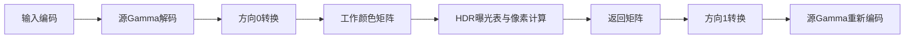

# HDR颜色转换链与sRGB残差

日期：2026-10-13。阶段1A继续。本轮补齐了一条有条件的宿主构造、接口调用和CUDA注册链，并据其数学关系检验已有数据。未拟合参数的sRGB候选在+1的最大RGB误差降至7.0122e−6；仍未证明完整运行公式。本轮没有新增Resolve帧，正式EXR累计48张。

## 静态连接得到什么支持

固定二进制中，已追HDR宿主函数属于一个float版本的RGBCorrector实现，其主表字节偏移0x10对应该方法。成功构造并正常返回时，该类构造器在对象+0x60保存一个对应float颜色转换实现；其三个接口槽分别通往矩阵转换、两Gamma转换和方向转换。结论保留分配失败、异常及后续替换的边界，不将构造器证据当作实际渲染实例快照。

四处CUDA注册把这些宿主stub连接到四个唯一的sm_120入口：矩阵、三通道Gamma、一通道Gamma及方向转换。入口从固定PTX记录按完整大括号边界提取；原先较宽的导航片段没有拿来当作完整入口。矩阵参数是36字节的by-value数据，源/目标图像则是分别传入的plane指针。

HDR前后的接口顺序为：

这是所追类型与条件下的静态候选链，不是本轮实际执行轨迹。Gamma转换还有相等快速路线、非空参数包及其他枚举的分支。本轮数学候选使用空参数包、相同分类的倍率1及方向转换的默认分支。内部读取的键为`TimelineColorSpaceType`与`TimelineGammaType`，其真实渲染值及与SDK设置的关系尚未捕获。

## 默认方向转换为何重要

令`P_a(v)=sign(v)*abs(v)^a`。已注册方向入口的默认分支，在方向0中先做约1/2.4次幂，再执行709形状的分段解码；方向非0中先做709形状的编码，再做约2.4次幂。枚举0、5在该默认分支的范围内；其他HDR枚举有单独处理，不能推广。

两Gamma入口中，所查枚举0具有带符号2.4次幂及其近似逆，枚举5具有sRGB形状的分段编解码，枚举6在该转换阶段保持输入。倍率位于解码之后、编码之前。矩阵入口将九个float系数按行运算，处在两端转换之间；实际矩阵数值还没有读到。

原生常量和运算并不是精确实数公式：2.4存为2.4000000953674316，逆指数为0.4166666567325592。默认709解码阈值是0.08100000023841858，而原冻结Colour逆式使用约0.081247944；编码阈值约0.018。PTX还使用近似log2/exp2/div、FTZ与FMA，不能把这些阶段作为逐位精确的互逆抵消。PTX的copysign以第一个输入提供符号、第二个输入提供幅值，按官方语义解释。[NVIDIA PTX8.7](https://docs.nvidia.com/cuda/archive/12.8.1/parallel-thread-execution/index.html#floating-point-instructions-copysign)。

## 新的条件性数学候选

[自有计算程序](../../experiments/evaluate-hdr-transfer-chain.py)使用理想十进制常量、0.081解码接点和float64运算，单独保留float32表及坐标存储；它没有执行或逐位仿真目标PTX。设`Dγ/Eγ`为假定源Gamma的编解码，`D709/E709`为这个参考模型中的709分段函数，候选工作变换为：

`Fγ(x) = D709(P_(1/2.4)(Dγ(x)))`

曝光计算之后，经`Eγ(P_2.4(E709(...)))`返回编码值。在理想2.4次幂源条件中，中间幂可以在实数模型里抵消，便得到此前接近原画面的709候选；sRGB源条件下则不会这样抵消。这个推导支持研究转换顺序，尚未证明已有渲染实际选中了相应枚举。

曝光部分沿用条件性端点/均值表和q坐标，分别比较直接`2^G`、理想插值和1/256权重量化。输出矩阵在共同XYZ倍率及精确逆矩阵的实数假设下可以抵消，但q仍依赖亮度权重；程序保留0.2126/0.7152/0.0722的假设，没有将矩阵消去当成实际矩阵证明。

| 已有数据 | 新链路＋直接2^G，+1最大误差 | 新链路＋理想表，−1 | 新链路＋理想表，+1 |
|---|---:|---:|---:|
| 原灰阶/纯色，假设枚举0 | 1.13374e−3 | 5.42752e−6 | 1.00268e−5 |
| 混色，假设枚举0 | 4.78437e−4 | 5.30249e−6 | 9.71800e−6 |
| 已配置sRGB，假设枚举5 | 1.19615e−3 | 3.72704e−6 | 7.01221e−6 |

此前sRGB数据中，五个固定逐通道候选的最小+1最大误差约0.0324549；新转换链先降至约0.001196，再加条件表降至约0.000007012。改善来自新静态关系和已有表候选，不是调整逐色块参数。量化插值版本的sRGB两档仍有4.26310e−6/7.93309e−6残差，且它在这里是CPU数学计算。[旧sRGB对照](resolve-hdr-srgb-seventh-pass.md)、[新后验数据](../experiments/hdr-transfer-chain-posthoc-result.json)。

## 验证及剩余工作

独立静态审查复核了函数片段、ABI、成功构造条件、四个注册和所选数学分支。另一份独立标量复核完成956项检查，覆盖18行、864个RGB预测及36项统计，最大差2.22045e−16；交叉计算阈值不作为原生公式验收标准。三份历史输入原始哈希及混色观测前冻结保持，旧global-grid工作区与Git的CRLF/LF差异单独记录，没有改写为字节相同。[审查](../reviews/hdr-color-transfer-review.md)、[来源清单](../experiments/hdr-color-transfer-evidence.json)。

下一步核对实际GPU模式、进一步模拟完整float32计算及矩阵精度，并绑定真实枚举和运行资源。当前关系只在已有有限非负RGB数据及规定条件下比较；其他Gamma/分区、边界与完整UI映射仍未验收，OpenCut公式尚未固定。
